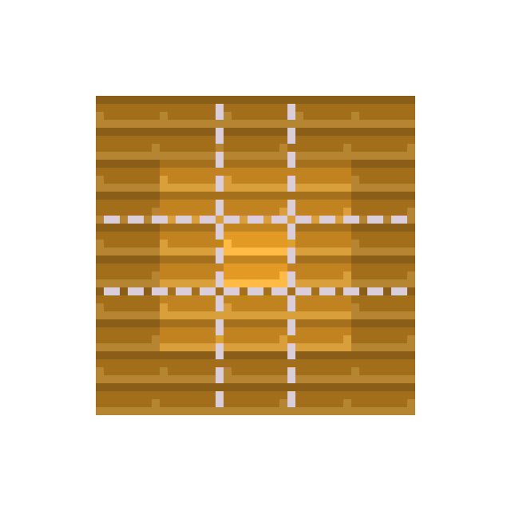

# Lachesis

A small suite of Aseprite extensions. Each one lives in its own folder under
`extensions/` and is packaged and installed separately. All need
**Aseprite 1.3 or newer** and work on Windows, macOS and Linux.

| | Extension | What it does |
| --- | --- | --- |
|  | [lachesis-enas](extensions/lachesis-enas/README.md) | Toggleable automatic snapshots of your work, saved next to the project, for timelapses |
|  | [lachesis-dyo](extensions/lachesis-dyo/README.md) | Remembers your open sprites and reopens them when Aseprite starts, like a browser restoring its last tabs |
|  | [lachesis-tria](extensions/lachesis-tria/README.md) | A tile library: slice tiles from the canvas, keep them in named groups, and reuse them in any project |
|  | [lachesis-tessera](extensions/lachesis-tessera/README.md) | Tiled preview of a selection: hold a key, or keep a live window open, to check that it repeats seamlessly |

## Build

From the repository root:

- macOS / Linux: `./scripts/build.sh` builds every extension, or
  `./scripts/build.sh lachesis-enas` builds just one.
- Windows: `powershell -File scripts\build.ps1` (same optional name argument).

Each extension ends up as `dist/<name>.aseprite-extension`. Double-click it, or
in Aseprite open **Edit > Preferences > Extensions > Add Extension**.

## Adding an extension

Create `extensions/<name>/` with its own `package.json` (whose `name` is
`<name>`), `src/`, `README.md` and `RELEASE.md`, then add a row to the table above.
`RELEASE.md` is a short paragraph on what the extension does plus its in-app
menu entries; every release's notes include it. The build
scripts and the release workflow pick it up automatically.

## Releases

Releases are built by GitHub Actions and are only started by hand:
**Actions > Release > Run workflow** on `main`, then pick a bump.

| Bump | Example | Use for |
| --- | --- | --- |
| `minor` | v0.3.2 → v0.4.0 | New dev release with features |
| `patch` | v0.3.2 → v0.3.3 | Bug fixes and small updates |

The major number stays at 0 for now. All extensions share one version number,
and each release attaches one `<name>-vX.Y.Z.aseprite-extension` per extension.
The release notes describe every extension and its menu, built from each
`RELEASE.md` by `scripts/release-notes.sh`. To refresh the notes of an existing
release, run **Actions > Release notes** with its tag.
