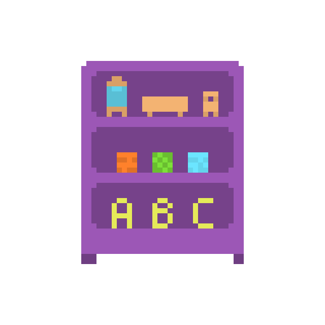

# Lachesis Tria

A tile library for pixel art, like an asset library. Slice tiles out of what is visible on the canvas, keep them in named groups, and reuse them in any project.

Requires Aseprite 1.3 or newer. Works on Windows, macOS and Linux.

## Capture tiles

**File > Scripts > Tile Library > Capture Tiles From Canvas...**

1. Set the grid:
   - **x** and **y**: where the first tile starts. Anything left of x or above y is ignored.
   - **Width** and **Height**: the size of each tile in pixels.

   The fields start with the grid you last used for this file, or the sprite's grid settings (View > Grid Settings) the first time.
2. Tria takes a snapshot of every **visible layer** in the **current frame**, exactly as the canvas shows it, and cuts it into tiles. It leaves out:
   - partial tiles at the right and bottom edges,
   - tiles that are fully transparent,
   - exact duplicates (only the first copy is kept).
3. All tiles start ticked. Click a tile to leave it out, or use **Tick All** / **Tick None**.
4. Pick a group (or type a new one), name the entry, and press **Save**. If the name is already taken in that group, you can replace it or keep both.

## Browse and stamp

**File > Scripts > Tile Library > Open Library...** opens the library browser. It is a small window that stays open beside the canvas while you draw. Drag its edges to make it bigger or smaller: the tile grid fills whatever space it has, and the window keeps that size (and its position) the next time you open it.

1. Pick a group and an entry from the two dropdowns at the top. Its tiles show as thumbnails. Scroll over the tiles, or use the arrow icons, to see more pages.
2. Click a tile. It becomes your brush and the pencil tool is selected, so a ghost of the tile follows the cursor.
3. Turn it with the icon buttons under the tiles. Hover an icon to see its name in the status line:

   | Icon | Does |
   | --- | --- |
   | Left / right arrow | Previous / next page |
   | Curved arrows | Rotate the stamp left / right (90 degrees) |
   | Mirror icons | Mirror the stamp horizontally / vertically |
   | Square | Reset rotation and mirroring |
   | Pencil | Edit entry: opens the entry file so you can change or delete tiles (each frame is one tile) |
   | Circle arrows | Reload the library from disk, after editing an entry |

   The status line under the icons shows the page and the current stamp.
4. Click on the canvas to stamp it. The tile's pixels are painted on the current layer, one undo step per click, and transparent pixels stay transparent. Keep clicking to stamp more copies. Turn on **View > Snap to Grid** to line stamps up with the grid.
5. To stop stamping, pick another brush or tool.

Rotating and mirroring also have menu commands (below), so you can bind keys to them and leave the browser small.

Stamps are plain pixels: nothing is linked back to the library, and no tileset or tilemap layer is created. If your sprite is indexed or grayscale, the tile's colors are mapped to the nearest colors of your sprite.

## Menu

Everything is under **File > Scripts > Tile Library**:

- **Capture Tiles From Canvas...**: slice the canvas into tiles and save them to a group.
- **Open Library...**: the library browser, for picking tiles to stamp.
- **Rotate Stamp Left** / **Rotate Stamp Right**: turn the current stamp 90 degrees.
- **Mirror Stamp Horizontally** / **Mirror Stamp Vertically**: flip the current stamp.
- **Tile Library Settings...**: where the library folder lives.

## Where the library lives

By default it lives in Aseprite's own config folder:

| OS | Folder |
| --- | --- |
| Windows | `%APPDATA%\Aseprite\lachesis-tria\library` |
| macOS | `~/Library/Application Support/Aseprite/lachesis-tria/library` |
| Linux | `~/.config/aseprite/lachesis-tria/library` |

You can pick a different folder in **Tile Library Settings...**, for example a synced folder to share the library between computers.

Each group is a folder. Each entry is an `.aseprite` file with one frame per tile, next to a `.preview.png` thumbnail sheet. You can open an entry file in Aseprite to edit or delete its tiles. The entry also remembers which file, frame and grid it was captured from.

## Shortcuts

The commands have no keyboard shortcut by default; you can bind one in **Edit > Keyboard Shortcuts** (search for "Stamp" to find the rotate and mirror commands, handy while stamping).

## Install

Build the package from the repository root with `./scripts/build.sh lachesis-tria` (or `powershell -File scripts\build.ps1 lachesis-tria` on Windows), then double-click the resulting `.aseprite-extension` file or add it in **Edit > Preferences > Extensions**.
